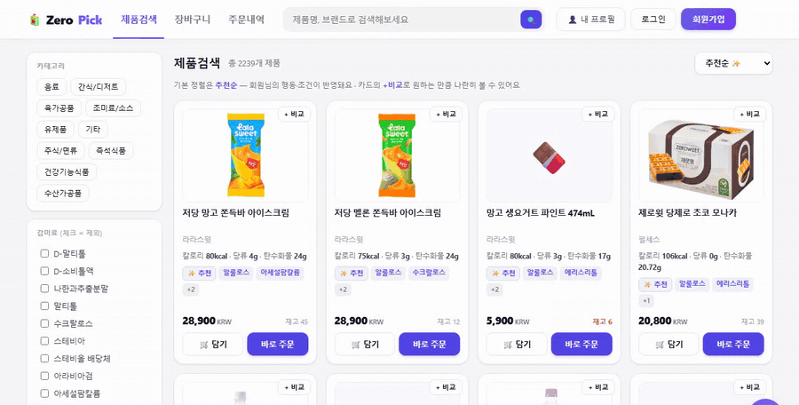
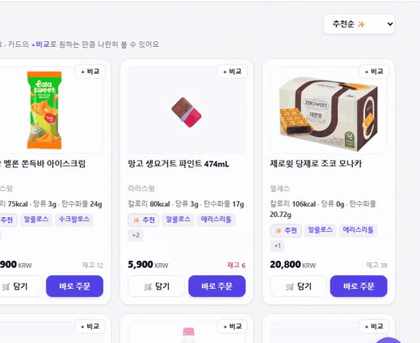
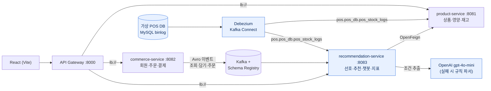
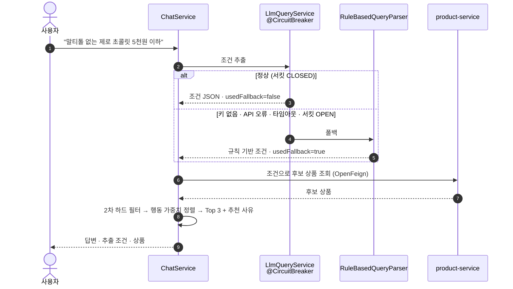
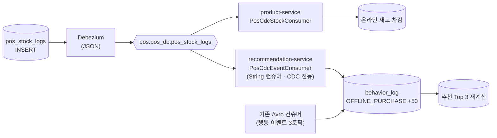

<div align="center">

# 🍫 제로픽 (ZeroPick)

**"말티톨 없는 제로 초콜릿 5천원 이하"처럼 물어보면<br/>못 먹는 감미료·알레르기를 걸러 근거와 함께 저당·제로 식품을 추천하는 MSA 커머스**

[✨ 개선 PR #55](https://github.com/2kmkmkm/Retail-AI-Shop/pull/55) · [📑 API 명세](docs/API명세서.md) · [📨 이벤트 스키마](docs/이벤트스키마.md)


-1565C0)
-F57C00)



</div>

## 📌 About
> LG CNS AM Inspire Camp 5기 미니 프로젝트 2 · 과제 [RTL-M] 리테일(난이도 중) · 7일 개발 + 08.20 최종 발표

- **문제**: 혈당·다이어트·알레르기 때문에 특정 감미료·성분을 피해야 하는 소비자는 상품마다 성분표를 직접 확인해야 합니다.
- **해결**: 못 먹는 감미료·알레르기·가격대를 등록하면 조회·구매 행동을 반영해 조건에 맞는 상품을 추천하고, 상담 챗봇이 자연어 질문에 상품과 추천 사유로 답합니다.
- **AI 흐름**: 자연어 질의 → **LLM은 조건 추출만**(gpt-4o-mini JSON Mode) → 상품 DB 조회 → 하드 필터(감미료·알레르기·가격·당류·칼로리) → 행동 가중치 정렬 → Top 3 + 추천 사유
- **성과**: 과제 핵심 10개·선택 10개 요구사항 모두 구현 + 난이도 상 핵심기술(CDC 실시간 재고 반영)까지 추가 구현

## 🙋‍♀️ My Role
**추천 마이크로서비스(`recommendation-service`) 단독 담당** — 커밋 56건(팀 최다) · PR 12건 · 추천 서비스 코드 약 97% 작성

- **LLM 상담 챗봇·자연어 검색** — OpenAI gpt-4o-mini로 조건 추출, **Resilience4j Circuit Breaker** + 규칙 기반 파서로 LLM 장애 시 자동 폴백, LLM 출력과 별개로 2차 하드 필터
- **행동 기반 개인화 추천** — Kafka(Avro) 행동 이벤트(조회·담기·주문) 소비 → 가중치 합산 Top 3, 행동 로그가 없는 신규 회원은 선호 조건 기반 추천
- **CDC 실시간 재고·추천 반영** — Debezium MySQL 커넥터로 가상 POS DB 판매 로그를 캡처, product·추천 두 서비스가 각자 소비
- **선호 조건(온보딩)·추천 성과 지표 API** — 감미료·알레르기·카테고리 선호 등록, 노출·클릭률·폴백률 집계
- 주 역할 외 — GitHub 레포·Issue/PR 템플릿 구축, 추천 서비스 Dockerfile·compose 구성, product-service 재고 차감 CDC 컨슈머 작성

## ✨ Features
| 상담 챗봇 | 개인화 추천 |
| :---: | :---: |
|  |  |
| 자연어 질문을 조건으로 바꿔 상품 Top 3와 추천 사유 제공,<br/>LLM 장애 시 "규칙 기반 응답"으로 계속 동작 | 조회·구매 행동을 반영해 상품 목록을 추천순으로 정렬하고<br/>✨추천 배지 표시 |

> 화면(React)은 팀원 구현이며, 위 기능의 백엔드 API·이벤트 처리를 담당했습니다. 오프라인 판매 실시간 반영(CDC)은 [Architecture](#-architecture)의 흐름도를 참고해 주세요. 회원·장바구니·주문·결제(commerce-service), 상품(product-service), 인프라·모니터링은 팀원이 구현했습니다.

## 🛠 Tech Stack
| 분류 | 기술 |
| :--- | :--- |
| **Backend** (담당) |       |
| **AI** (담당) |  |
| **Messaging·CDC** (담당) |  -231F20?style=flat)  -4479A1?style=flat&logo=mysql&logoColor=white) |
| **MSA 인프라** (팀) | -6DB33F?style=flat&logo=spring&logoColor=white)     |
| **Frontend** (팀) |   |
| **Infra · Tools** |    |

## 🏗 Architecture


<sub>파란색: 본인 담당 · Eureka(:8761) · Config(:8888) · 모니터링(Prometheus·Grafana·Zipkin)·EFK는 팀원 구축</sub>

<details>
<summary><b>담당 서비스 흐름 — 상담 챗봇 · CDC 이중 소비</b></summary>

<br/>

**상담 챗봇** (`POST /recommendation-service/chat`)



**CDC 이중 소비** — 하나의 토픽을 두 서비스가 각자 소비


</details>

## 🔥 Troubleshooting
<details>
<summary><b>LLM 장애에도 멈추지 않는 챗봇 — Circuit Breaker + 규칙 파서 폴백으로 30/30 폴백 응답, 폴백 평균 222~286ms</b></summary>

<br/>

- **문제**: 핵심 요구사항(AI 기능)인 챗봇이 외부 API(OpenAI)에 의존해, 키 미설정·네트워크 오류·지연 시 챗봇과 자연어 검색이 함께 실패하는 구조였습니다. LLM 경로는 평균 약 3.2초로 지연 편차도 컸습니다.
- **원인**: 장애 지점을 ① LLM 호출 실패·지연 ② LLM 출력 오류(조건 누락·잘못된 값) ③ 상품 서비스 조회 실패로 나눠 확인했습니다.
- **해결**
  - 대안 비교: try-catch + 타임아웃(장애가 이어져도 매 요청이 타임아웃까지 대기) / 재시도(장애 지속 시 지연 증가) / **Circuit Breaker + 규칙 파서 폴백**
  - 시연 중 "응답 없음"이 가장 큰 위험이라 연속 실패 시 호출 자체를 차단하는 Circuit Breaker를 선택했고, 규칙 파서는 LLM과 같은 `SearchCondition` 출력 형식으로 만들어 자연어 검색에도 재사용했습니다.
  - LLM 출력을 그대로 믿지 않도록 조회한 후보를 메모리에서 감미료·알레르기·가격·당류·칼로리로 한 번 더 필터링했습니다.
  - 직접 호출 테스트에서 정상 LLM 응답이 2초 타임아웃에 걸려 폴백으로 빠지는 문제를 발견해 타임아웃을 5초로 올리고, 2초 초과는 slow call로만 집계했습니다.
- **결과** (팀 측정 리포트 기준)
  - LLM 키를 뺀 상태에서 **30문장 모두 폴백 응답**, 폴백 평균 **222~286ms**(목표 300ms)
  - LLM 경로 제외 감미료 위반 **0건** — 상품 선정을 LLM이 아닌 DB 조회·필터가 하므로 없는 상품을 지어낼 수 없는 구조
  - 폴백은 구어체 질의에서 추출률이 떨어지는 한계를 확인 → 프로젝트 종료 후 개선(아래)
</details>

<details>
<summary><b>CDC 직렬화 형식 불일치 — Avro 컨슈머와 분리한 CDC 전용 컨슈머로 기존 이벤트 처리에 영향 없이 해결</b></summary>

<br/>

- **문제**: 오프라인 매장(가상 POS DB)의 판매를 온라인 재고·추천에 반영하는 CDC를 구축했는데, Debezium이 JSON으로 발행한 메시지를 행동 이벤트용 Avro 컨슈머로 읽어 역직렬화 에러가 났습니다.
- **원인**: Kafka Connect는 `JsonConverter`, 추천 서비스 컨슈머는 `KafkaAvroDeserializer` — 발행 측과 소비 측 형식이 달랐습니다. (PR 리뷰에서 지적받고 String 컨슈머 방식을 제안받음)
- **해결**
  - 대안 비교: Connect를 Avro로 변경(형식 통일, 단 다른 파트 인프라 설정 변경) / **CDC 전용 컨슈머 분리**(기존 컨슈머 그대로)
  - 마감 하루 전이라 이미 동작 중인 행동 이벤트 컨슈머(3토픽)를 건드리지 않는 쪽을 선택해, String 컨슈머 팩토리를 별도 빈으로 분리하고 Debezium envelope(`payload.after`)을 파싱했습니다.
  - 같은 구조를 product-service에도 적용해 기존 재고 차감 로직(`StockService.deduct()`)을 재사용했고, 컨슈머 그룹을 서비스별로 나눠 한 토픽을 두 서비스가 각자 소비하게 했습니다.
- **결과**: POS DB에 판매 1건 INSERT → **온라인 재고 차감 + 해당 회원 추천 Top 3 갱신**, 기존 Avro 컨슈머와 영향 없이 공존 (로컬·Docker 환경 확인)
- **남은 과제**: 실패 메시지 재시도·DLT, 중복 수신 시 재고 이중 차감을 막는 멱등성 처리
</details>

<details>
<summary><b>(프로젝트 종료 후 개선) 폴백 파서 제외 감미료 인식률 — 구어체 질의 0% → 100%</b></summary>

<br/>

> [PR #55](https://github.com/2kmkmkm/Retail-AI-Shop/pull/55)로 공개 · 팀 리뷰 규칙(승인 1개 필수)상 `develop`에는 병합하지 않고 발표 시점 코드를 유지했습니다.

- **문제**: 팀 측정 문장을 본인 코드의 규칙 파서에 다시 넣어 보니 구어체·오타 질의 12문장에서 제외 감미료를 하나도 뽑지 못했습니다. 제외 감미료를 놓치면 하드 필터도 작동하지 않아 위반 추천으로 이어집니다.
- **원인**: 실패 문장을 유형별로 분류
  - "○○ 없는/빼고"처럼 감미료 바로 뒤 부정어만 인식 → "싫어", "피하고싶어", "절대 안됨" 미인식
  - 감미료를 1개만 저장 → "말티톨이랑 아스파탐 둘 다" 불가
  - 오타·약칭 미대응(아쓰파탐, 솔비톨) + 파서가 뽑은 "소르비톨"과 DB 이름 "D-소비톨액" 불일치로 걸러지지 않음
- **해결**
  - 대안 비교: 정규식 패턴 추가(패턴 폭증) / 형태소 분석기(의존성·기동 시간 증가) / **감미료 사전 + 문맥 판정**
  - 폴백은 LLM 장애 시에도 가볍게 항상 동작해야 하므로 외부 의존성 없는 방식을 선택했습니다.
  - `SweetenerDictionary`로 오타·약칭을 DB 정식명으로 변환, 감미료 뒤 첫 판정 표현(부정/긍정)으로 제외 여부 결정, 복수 감미료 지원, LLM 결과도 같은 사전으로 정규화
  - JUnit 5 파라미터화 테스트 26케이스 작성
- **결과**

  | 세트 | 개선 전 | 개선 후 |
  | :--- | :---: | :---: |
  | 기본(정형) 6문장 | 83% | **100%** |
  | 확장(구어체·오타) 12문장 | 0% | **100%** |
  | 검증(개선 전 따로 만든 새 문장) 10문장 | 10% | **100%** |

  - 다른 조건(가격·칼로리·카테고리) 추출 결과는 변화 없음, 테스트 26/26 통과
</details>

<details>
<summary><b>📂 Folder Structure · 🚀 Getting Started</b></summary>

<br/>

> 교육 과정 종료로 EC2 배포 서버는 접속할 수 없습니다. 아래는 로컬 실행 방법입니다.

```text
service-discovery/       Eureka (:8761)
config-service/          Spring Cloud Config (:8888)
apigateway-service/      Spring Cloud Gateway (:8000)
product-service/         상품·영양·재고 + POS CDC 재고 컨슈머
commerce-service/        회원·장바구니·주문·모의결제·행동 이벤트 발행
recommendation-service/  선호·추천·챗봇·자연어 검색·지표 (담당)
frontend/                React · Vite
docs/                    ERD · API 명세 · 이벤트 스키마 · CDC 커넥터 설정
scripts/                 Avro 스키마·CDC 커넥터 자동 등록, POS DB 초기화
```

```bash
# LLM 키가 없으면 챗봇은 규칙 기반 폴백으로 동작합니다
export LLM_API_KEY=sk-...

docker compose up -d     # 인프라·서비스·초기화 컨테이너(토픽·스키마·CDC 커넥터) 한 번에 기동

# 매장 판매 1건 기록 → CDC로 재고·추천에 반영
docker exec -i pos-db mysql --default-character-set=utf8mb4 -uroot -proot pos_db \
  -e "INSERT INTO pos_stock_logs (store_id, member_id, product_id, category, changed_qty, event_type)
      VALUES ('STORE_GANGNAM', 1, 1, '간식/디저트', 2, 'OFFLINE_PURCHASE');"
```

- 계약 문서: [ERD](docs/제로픽_ERD.dbml) · [API 명세](docs/API명세서.md) · [OpenAPI](docs/openapi/openapi.yaml) · [이벤트 스키마](docs/이벤트스키마.md) · [CDC 커넥터](docs/cdc/pos-inventory-connector.json)
</details>
